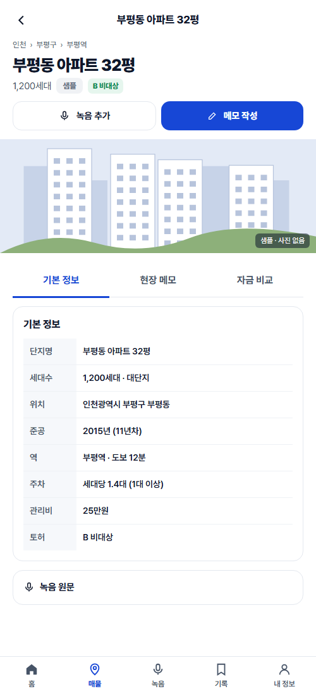
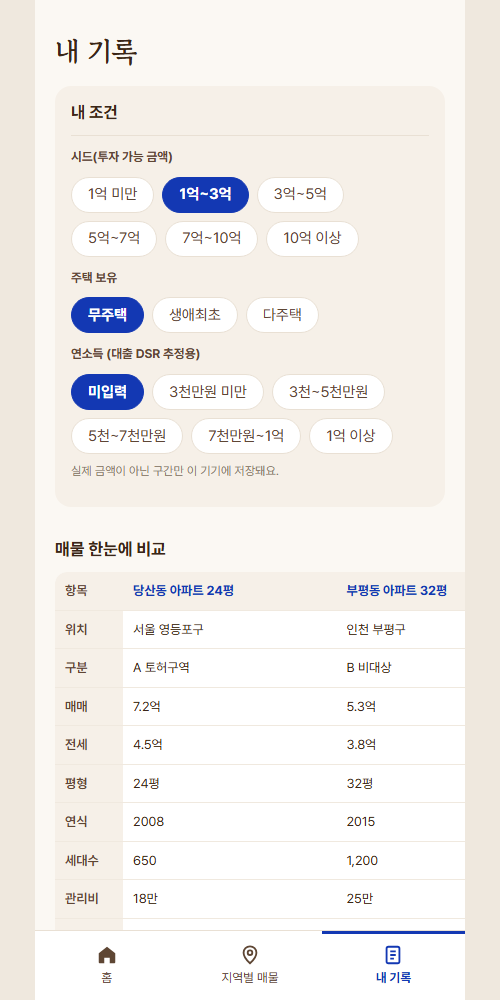
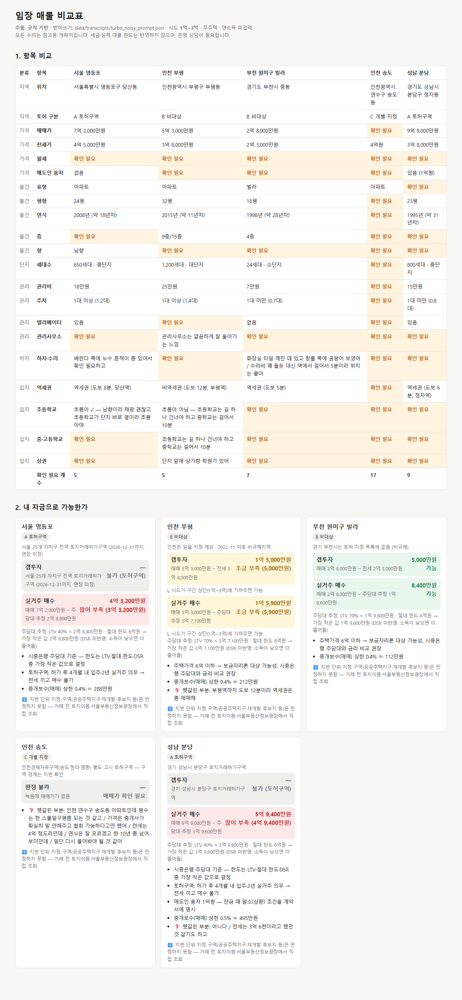

# 임장 음성메모 → 매물 비교표 + "내 자금으로 가능한가" 판정

> 현장에서 말로 남긴 임장 녹음을 넣으면, **같은 항목의 비교표**와 **토허구역을 반영한 필요자금 판정**이 자동으로 나온다.

```
음성 녹음 ─▶ ① Whisper 받아쓰기 ─▶ ② 항목 추출(규칙 / Claude) ─▶ ③ 토허 판정 · 자금 계산 ─▶ 비교표(HTML/MD)
            (Colab, GPU)            (내 컴퓨터)                  (내 컴퓨터, 규정값 고정)
```

| 문서 | 내용 |
|---|---|
| [01_문제정의서.md](01_문제정의서.md) | 도메인, 현재 문제, 개선 가설, 대상 사용자, 성공 기준 |
| [02_모델선정.md](02_모델선정.md) | Whisper·edge-tts·추출 방식 선정 근거, 후보 비교 |
| [03_검증결과.md](03_검증결과.md) | 시간·정확도 비교, 자금 판정 수계산 대조, 실패 사례, 한계 |

## 모바일 웹앱 — 집노트

파이프라인 결과를 폰에서 보는 화면. 홈 → 지역별 매물 → 매물 상세 → 내 기록(조건 변경·비교표).
'내 조건'에서 시드·보유 상태·소득 구간을 바꾸면 자금 판정이 앱 안에서 바로 다시 계산된다.

| 홈 | 지역별 매물 | 매물 상세 | 내 기록 |
|---|---|---|---|
|  |  |  |  |

**내 폰으로 직접 쓰기** — 녹음 시작 → 말하는 동안 실시간 받아쓰기 → (틀린 글자 수정) → 정리하기 → 비교표·토허 판정·자금 판정이 바로 나온다.
- 받아쓰기: 폰 브라우저 내장 음성인식(Web Speech API, ko-KR). 지원하지 않는 브라우저는 키보드 🎤 음성 입력으로 대신한다.
- 항목 추출·토허 판정·자금 계산: [`app/engine.js`](app/engine.js)가 폰 안에서 처리 (Python 파이프라인과 1,260칸 동일 — `node tools/test_engine.cjs`).
- 저장: 내 매물은 **이 폰에만** 저장된다(서버로 보내지 않음). '내 기록'에서 백업 파일을 받을 수 있다.
- 홈 화면에 추가하면 앱처럼 쓸 수 있다 (Android Chrome: 메뉴 → 홈 화면에 추가 / iPhone Safari: 공유 → 홈 화면에 추가).
- 마이크는 https 주소에서만 켜진다 → GitHub Pages 배포 주소로 연다.

내 컴퓨터에서 실행 (저장소 폴더에서):

```bash
python -m http.server 8000
```

브라우저에서 `http://localhost:8000/app/` 을 연다. 샘플 데이터 갱신은 `python tools/export_app.py`.
- 사진은 아직 없음(다음 단계: 사진 업로드 연결).

## 결과 미리보기 (PC용 비교표)

소음을 섞은 AI 음성 → Whisper turbo 받아쓰기 → 규칙 기반 추출로 만든 실제 결과 (`outputs/report.html`):



**검증 요약** ([03_검증결과.md](03_검증결과.md))
- 1건 처리 시간: 손 정리 15~30분 → **약 1.7초** (받아쓰기 포함, Colab T4)
- 항목 추출 정확도: **99%** (75칸 중 74칸, turbo + 소음 + 용어 힌트, 규칙 v2) — 목표 85% 달성 (v1은 97%)
- 누락 항목 '확인 필요' 표시: 17/17 전부 정확
- 자금 판정: 수계산과 5건 모두 일치
- 오픈소스 LLM(Qwen2.5-7B) 추출과 비교: 정정한 말("아 아니다 3억 6천")은 LLM만 맞혔고, 정해진 말투에서는 규칙 기반이 더 정확·빠름

같은 시드(1억~3억, 무주택)로 돌린 예:

| 매물 | 토허 구분 | 갭투자 | 실거주 매수 |
|---|---|---|---|
| 서울 영등포 7.2억 | A 토허구역 | 불가 | 🔴 많이 부족 (3억 3,200만원) |
| 인천 부평 5.3억 | B 비대상 | 🟡 조금 부족 (5,000만원) | 🟡 조금 부족 (5,900만원) |
| 부천 원미구 빌라 2.8억 | B 비대상 | 🟢 가능 | 🟢 가능 |
| 인천 송도 | C 개별 지정 | 매매가 확인 필요 | — |
| 성남 분당 9.9억 | A 토허구역 | 불가 | 🔴 많이 부족 (4억 9,400만원) |

---

## 실행 방법

### 1단계 — Colab: 샘플 음성 만들기 + 받아쓰기 (약 10분)

1. [`colab/01_음성생성_받아쓰기.ipynb`](colab/01_음성생성_받아쓰기.ipynb) 를 Colab에서 연다 (colab.research.google.com → 파일 → 노트북 업로드).
2. `런타임 → 런타임 유형 변경 → T4 GPU`
3. 위에서부터 ▶ 를 차례로 실행. "2. AI 목소리 샘플 올리기" 칸에서 저장소의 **`audio_clean.zip`** 을 고른다.
   (음성은 `python tools/make_audio.py` 로 edge-tts를 써서 만든 것. Colab에서는 edge-tts 서버 연결이 막히는 경우가 있어 미리 만들어 둠)
4. 마지막 칸에서 `imjang_stt_results.zip` 이 내려받아진다.
5. 압축을 풀어 `transcripts/` 안의 파일은 `data/transcripts/`, `audio/` 는 `data/audio/` 에 넣는다.

> 이 저장소의 `data/transcripts/` 에 이미 8개 조건의 받아쓰기 결과가 들어 있으므로, 1단계를 건너뛰고 2단계부터 해도 같은 결과가 나온다.
> 바로 열기: [Colab에서 열기](https://colab.research.google.com/github/agogdim99-ux/imjang-voice-memo/blob/main/colab/01_%EC%9D%8C%EC%84%B1%EC%83%9D%EC%84%B1_%EB%B0%9B%EC%95%84%EC%93%B0%EA%B8%B0.ipynb)

### 2단계 — 내 컴퓨터: 비교표 만들기 (설치 거의 없음)

Python 3.10 이상만 있으면 된다. 추가 패키지 설치는 필요 없다.

```bash
python run.py
```

질문 3개(시드 구간 · 주택 보유 상태 · 연소득 구간)에 번호로 답하면 `outputs/report.html` 이 만들어진다. 브라우저로 열면 된다.

질문 없이 한 번에 실행:

```bash
python run.py --transcripts data/transcripts/turbo_noisy_prompt.json --seed 2 --buyer 무주택 --income 0
```

8개 조건 전부 돌리고 채점하기 (Git Bash):

```bash
for f in data/transcripts/*.json; do python run.py --transcripts "$f" --seed 2 --buyer 무주택 --income 0 --method rules; done; python run.py --seed 2 --buyer 무주택 --income 0 --method rules; python evaluate.py
```

| 옵션 | 값 |
|---|---|
| `--transcripts` | 받아쓰기 결과 JSON. 생략하면 대본 원문(`data/scripts.json`) |
| `--seed` | 1: 1억 미만 · 2: 1억~3억 · 3: 3억~5억 · 4: 5억~7억 · 5: 7억~10억 · 6: 10억 이상 |
| `--buyer` | 무주택 · 생애최초 · 다주택 |
| `--income` | 0: 미입력 · 1: 3천 미만 · 2: 3천~5천 · 3: 5천~7천 · 4: 7천~1억 · 5: 1억 이상 (만원) |
| `--method` | `rules` 규칙 기반 · `qwen` 오픈소스 LLM(Colab 결과) · `llm` Claude · `auto`(기본: Claude 키나 저장된 결과가 있으면 Claude, 아니면 규칙) |

### 3단계 — 정확도 채점

```bash
python evaluate.py
```

`outputs/` 의 모든 추출 결과를 정답표와 비교해 `outputs/evaluation.md` 를 만든다.

### (선택) 오픈소스 LLM(Qwen2.5-7B) 추출로 비교하기

[`colab/02_LLM_항목추출.ipynb`](colab/02_LLM_항목추출.ipynb)를 Colab T4에서 실행하면 된다 ([Colab에서 열기](https://colab.research.google.com/github/agogdim99-ux/imjang-voice-memo/blob/main/colab/02_LLM_%ED%95%AD%EB%AA%A9%EC%B6%94%EC%B6%9C.ipynb), 약 15분). 실행 결과는 이미 `data/llm_extracted/qwen.json` 에 들어 있다.

```bash
python run.py --transcripts data/transcripts/turbo_noisy_prompt.json --seed 2 --buyer 무주택 --income 0 --method qwen
```

### (선택) Claude 추출 켜기

```bash
pip install -r requirements.txt
```

API 키를 환경변수 `ANTHROPIC_API_KEY` 로 넣고 `--method llm` 으로 실행한다. 결과는 `outputs/cache_llm/` 에 저장되어 키가 없는 사람도 같은 결과를 재현한다.

---

## 폴더 구조

```
├─ 01_문제정의서.md / 02_모델선정.md / 03_검증결과.md
├─ colab/01_음성생성_받아쓰기.ipynb   ① 음성 내려받기 + 소음 섞기 + Whisper 8조건 비교
├─ colab/02_LLM_항목추출.ipynb       ② 오픈소스 LLM(Qwen2.5-7B) 항목 추출
├─ data/
│   ├─ scripts.json                  대본 5개 (허구의 매물)
│   ├─ ground_truth.json             항목 정답표 (75칸)
│   ├─ audio/clean/                  AI 음성 샘플 (tools/make_audio.py)
│   └─ transcripts/                  받아쓰기 결과 8조건 + stt_results.csv (Colab 결과)
├─ audio_clean.zip                   Colab이 내려받는 음성 묶음
├─ docs/                             결과 화면 캡처
├─ imjang/
│   ├─ schema.py                     고정 항목표
│   ├─ extract_rules.py              규칙 기반 추출기
│   ├─ extract_llm.py                Claude 추출기 (구조화 출력)
│   ├─ extract_open.py               Qwen 추출 결과 읽기
│   ├─ regions.py                    수도권 지역 정규화 + 토허 A/B/C 판정
│   ├─ finance.py                    LTV·절대 한도·DSR, 시드 구간 판정, 중개보수
│   └─ report.py                     비교표 HTML/MD
├─ run.py                            전체 실행
├─ evaluate.py                       정확도 채점
├─ tools/                            노트북 생성(build_notebook*.py), 음성 생성(make_audio.py), LLM 실행 스크립트
└─ outputs/                          결과물 (report.html 등)
```

## 주의

- 모든 결과는 **참고용 개략치**이며 투자 판단의 근거가 아니다. 대출 한도는 소득·신용·부채에 따라 달라지므로 은행 상담이 필요하다.
- 토지거래허가구역 기준: **2026년 11월**. 지정은 2026-12-31 만료 예정(화성 동탄·구리·용인 기흥은 2027-12-31)이며, 지번 단위 구역은 판정하지 못한다. 거래 전 토지이음·서울부동산정보광장에서 직접 조회할 것.
- 샘플 음성은 AI 합성이며 매물 정보는 허구다. 개인 목소리·실제 매물 정보는 저장소에 없다.
