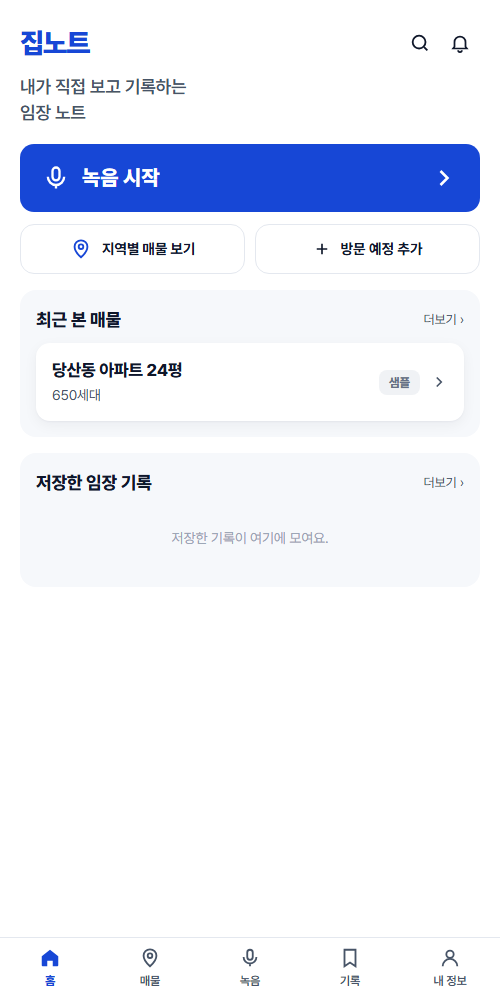
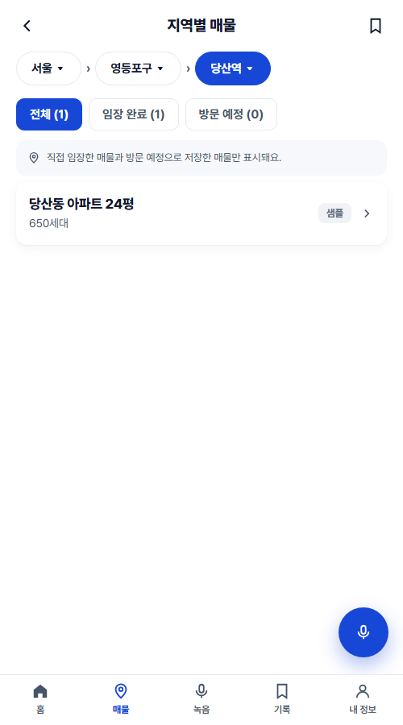
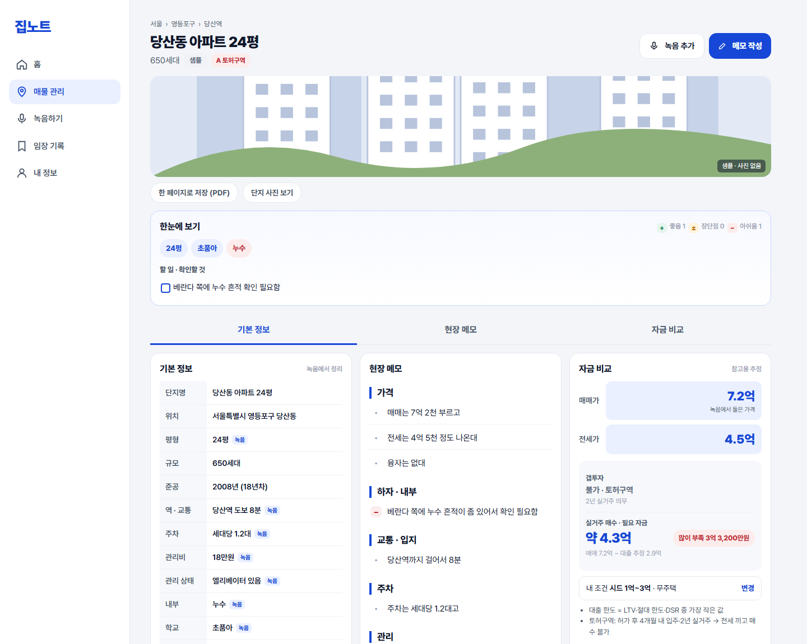

# 집노트 — 임장 음성메모를 매물 비교표와 "내 자금으로 가능한가" 판정으로

> 현장에서 말로 남긴 임장 녹음을 넣으면 **같은 항목의 매물 정리**, **토지거래허가구역을 반영한 필요 자금 판정**이 자동으로 나온다.
> 상업용 부동산 PM 4년 경력의 투자 준비자가 직접 쓰려고 만든 PoC.

**데모 (폰에서 열기): https://agogdim99-ux.github.io/imjang-voice-memo/app/**

| 제출물 | 파일 |
|---|---|
| 문제 정의서 | [01_문제정의서.md](01_문제정의서.md) — 도메인, 현재 문제, 개선 가설, 대상 사용자, 성공 기준 |
| 모델 선정 근거 | [02_모델선정.md](02_모델선정.md) — Whisper·edge-tts·Qwen2.5-7B·폰 음성인식 선정 이유, 후보 비교 |
| PoC 코드·노트북 | [`colab/`](colab) 노트북 2개, [`imjang/`](imjang) 파이프라인, [`app/`](app) 폰 웹앱 |
| 개선 효과 검증 | [03_검증결과.md](03_검증결과.md) — 시간·정확도 비교, 받아쓰기 8조건, LLM 비교, 실제 녹음 검증, 실패 사례, 한계 |
| 실행 방법·시연 | 이 문서 |

---

## 결과 요약 (성공 기준 대비)

| 성공 기준 (문제 정의서 5장) | 목표 | 결과 | |
|---|---|---|---|
| 매물 1건 정리 시간 | 2분 이내 | 손 정리 15~30분 → **약 1.7초** (Whisper 받아쓰기 포함) / 폰 앱은 녹음 끝나면 즉시 | 달성 |
| 항목 추출 정확도 | 85% 이상 | **99%** (75칸 중 74칸, Whisper turbo + 소음 + 용어 힌트) | 달성 |
| 비교 가능성 | 전 매물 동일 항목 표 | 모든 매물이 같은 항목표로 출력 | 달성 |
| 누락 항목 안내 | 미언급 항목 "확인 필요" | 17칸 중 17칸 정확 | 달성 |
| 자금 판정 | 시드 구간 대비 자동 판정 | 수계산과 5건 모두 일치 | 달성 |
| 가독성 | 표만 봐도 이해 | 실제 녹음 2건: 혼잣말 121단어 → 주제별 14줄 + 핵심 태그 9개 | 정성 확인 |

```
[PoC 검증]  AI 음성 ─▶ ① Whisper 받아쓰기 ─▶ ② 항목 추출 (규칙 / Qwen2.5-7B) ─▶ ③ 토허 판정·자금 계산 ─▶ 비교표
            (edge-tts)   (Colab T4, 8조건 비교)                                    (규정값 고정, 코드 계산)

[폰 앱]     내 목소리 ─▶ 폰 음성인식(실시간) ─▶ 받아쓰기 교정 ─▶ 혼잣말 정리 ─▶ 기본 정보 · 현장 메모 · 자금 비교
                                                                 (선택) Claude + 웹 검색: 단지 정보·실거래가
```

---

## 시연 — 폰 웹앱 '집노트'

| 홈 | 지역별 매물 | 매물 상세 (현장 메모) |
|---|---|---|
|  |  |  |

PC 화면 (왼쪽 메뉴 + 기본 정보 · 현장 메모 · 자금 비교 3칸):



**쓰는 방법**
1. 녹음 시작 → 처음에 단지 이름을 말하고, 본 것을 평소처럼 말한다 ("지금 문래자이 왔어, 대단지고 역 바로 앞…")
2. 말하는 동안 실시간으로 글자가 나온다. 녹음 중엔 화면이 꺼지지 않고, 끊겨도 받아쓴 글은 임시 저장된다.
3. 정리하기 → 키·서버 없이 폰 안에서 바로 정리된다.

**정리 결과**
- **한눈에 보기**: 핵심 태그(초역세권 · 대단지 · 50평 · 관리비 저렴 · 누수 …), 좋음(+) · 장단점(±) · 아쉬움(−) 개수, 할 일(사진 첨부하기, 매매가 확인 …)
- **기본 정보**: 단지명·위치·평형·규모·준공·역/교통·출퇴근·주차·관리비·관리 상태·내부·학교·생활 편의·토허 구분 (녹음에서 나온 값은 '녹음' 표시)
- **현장 메모**: 혼잣말을 문장으로 나누고 군말(음·뭐·막·이거 뭐야)과 고쳐 말한 앞말을 빼고 메모체로 다듬어, 교통·입지 / 주차 / 관리 / 하자·내부 / 학군 / 생활·상권 / 가격으로 묶는다
- **자금 비교**: 토허 판정 + 내 시드·주택 보유·소득 구간 기준 필요 자금 (가능 / 조금 부족 / 많이 부족)

**그 밖의 기능**: 사진 여러 장(카메라·앨범, 크게 보기), 단지 위치 지도, 방문 예정 → 임장 완료 관리, 메모 작성, 기록 검색과 한눈에 비교표, A4 한 장 PDF 저장, 홈 화면에 추가(앱처럼 사용), 홈에서 뒤로 두 번 누르면 종료

**개인정보**: 녹음 내용·사진·매물은 그 폰의 브라우저에만 저장되고 서버로 보내지 않는다. 시드는 실제 금액이 아닌 구간만 저장한다. (선택 기능인 Claude 자동 정리를 켤 때만 녹음 글이 Anthropic API로 전송된다.)

---

## 실행 방법

### A. 폰 앱 (설치 없음)
위 데모 주소를 폰 Chrome(Android) 또는 Safari(iPhone)로 연다. 마이크 권한을 허용하면 바로 녹음할 수 있다. (iPhone은 Siri가 켜져 있어야 음성인식이 된다. 음성인식은 인터넷 연결 필요.)

내 컴퓨터에서 띄우기:

```bash
python -m http.server 8000
```

브라우저에서 `http://localhost:8000/app/` 을 연다.

### B. PoC 검증 재현

**1단계 — Colab: 받아쓰기 8조건 (약 10분, T4 GPU)**

[Colab에서 열기](https://colab.research.google.com/github/agogdim99-ux/imjang-voice-memo/blob/main/colab/01_%EC%9D%8C%EC%84%B1%EC%83%9D%EC%84%B1_%EB%B0%9B%EC%95%84%EC%93%B0%EA%B8%B0.ipynb) → `런타임 → 런타임 유형 변경 → T4 GPU` → `런타임 → 모두 실행`.
음성(`audio_clean.zip`)은 저장소에서 자동으로 내려받는다. 결과는 이미 [`data/transcripts/`](data/transcripts)에 들어 있으므로 건너뛰어도 된다.

**2단계 — 내 컴퓨터: 비교표 만들기 (Python 3.10+, 추가 설치 없음)**

```bash
python run.py --transcripts data/transcripts/turbo_noisy_prompt.json --seed 2 --buyer 무주택 --income 0 --method rules
```

`outputs/report.html` 을 브라우저로 연다. 옵션 없이 `python run.py` 로 실행하면 질문에 번호로 답하면 된다.

| 옵션 | 값 |
|---|---|
| `--transcripts` | 받아쓰기 결과 JSON (생략하면 대본 원문) |
| `--seed` | 1: 1억 미만 · 2: 1억~3억 · 3: 3억~5억 · 4: 5억~7억 · 5: 7억~10억 · 6: 10억 이상 |
| `--buyer` | 무주택 · 생애최초 · 다주택 |
| `--income` | 0: 미입력 · 1: 3천 미만 · 2: 3천~5천 · 3: 5천~7천 · 4: 7천~1억 · 5: 1억 이상 (만원) |
| `--method` | `rules` 규칙 기반 · `qwen` 오픈소스 LLM 결과 · `llm` Claude(API 키 필요) |

**3단계 — 정확도 채점**

```bash
for f in data/transcripts/*.json data/scripts.json; do python run.py --transcripts "$f" --seed 2 --buyer 무주택 --income 0 --method rules; done
python evaluate.py
```

`outputs/evaluation.md` 에 조건별 정확도와 틀린 칸이 정리된다.

**(선택) 오픈소스 LLM 비교** — [Colab에서 열기](https://colab.research.google.com/github/agogdim99-ux/imjang-voice-memo/blob/main/colab/02_LLM_%ED%95%AD%EB%AA%A9%EC%B6%94%EC%B6%9C.ipynb) (Qwen2.5-7B, 약 15분). 결과는 [`data/llm_extracted/qwen.json`](data/llm_extracted/qwen.json)에 있고 `--method qwen` 으로 채점된다.

**(선택) 앱 엔진 검사** — 폰 앱(JS)이 Python 파이프라인과 같은 결과를 내는지:

```bash
node tools/test_engine.cjs
```

---

## 폴더 구조

```
├─ 01_문제정의서.md · 02_모델선정.md · 03_검증결과.md
├─ app/                              폰 웹앱 '집노트' (GitHub Pages로 배포)
│   ├─ index.html                    화면 (홈 · 매물 · 녹음 · 기록 · 내 정보, 상세 3탭)
│   ├─ engine.js                     받아쓰기 교정 · 항목 추출 · 혼잣말 정리 · 지역/토허 판정
│   ├─ ai.js                         (선택) Claude + 웹 검색 자동 정리
│   └─ data.js                       샘플 매물 1건
├─ colab/01_음성생성_받아쓰기.ipynb    Whisper small/turbo × 깨끗/소음 × 용어 힌트 8조건
├─ colab/02_LLM_항목추출.ipynb        Qwen2.5-7B (4비트) 항목 추출
├─ imjang/                           Python 파이프라인 (schema · extract_rules · extract_llm · extract_open · regions · finance · report)
├─ run.py · evaluate.py              실행 · 채점
├─ data/
│   ├─ scripts.json · ground_truth.json   대본 5건(허구 매물) · 정답표 75칸
│   ├─ audio/clean/ · audio_clean.zip     AI 합성 음성
│   ├─ transcripts/                       받아쓰기 8조건 결과 + stt_results.csv
│   ├─ llm_extracted/qwen.json            Qwen 추출 결과
│   └─ field/field_recordings.json        실제 현장 녹음 2건의 받아쓰기·정리 결과
├─ outputs/                          비교표(report.html) · 채점(evaluation.md)
├─ tools/                            노트북·음성·앱 데이터 생성, 앱 엔진 검사
└─ docs/                             화면 캡처
```

## 주의

- 모든 결과는 **참고용 개략치**이며 투자 판단의 근거가 아니다. 대출 한도는 소득·신용·부채에 따라 달라지므로 은행 상담이 필요하다. 세금은 계산하지 않는다.
- 토지거래허가구역 기준: **2026년 11월**. 지정은 2026-12-31 만료 예정(화성 동탄·구리·용인 기흥은 2027-12-31)이며, 지번 단위 구역은 판정하지 못한다. 거래 전 토지이음·서울부동산정보광장에서 직접 조회할 것.
- 검증용 샘플 음성은 AI 합성이며 매물 정보(가격 등)는 허구다. 실제 현장 녹음 2건은 받아쓴 글만 포함했고, 목소리 파일은 저장소에 없다.
